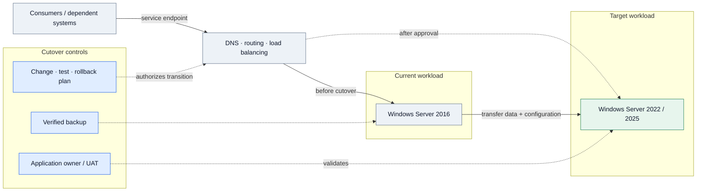
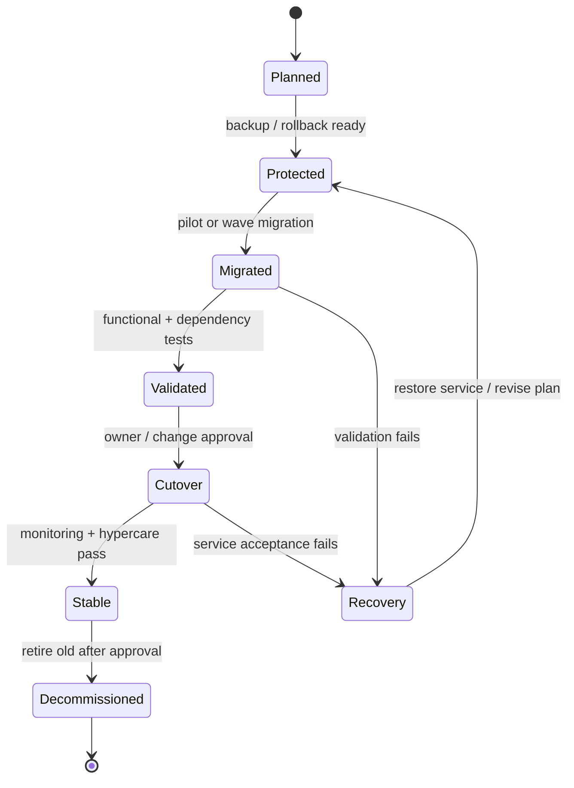

# IP-02: Windows Server 2016 Migration Implementation

> **Type:** Repeatable Service Package  
> **Delivery Unit:** 1 Migration Wave หรือชุด Workloads ที่ตกลง; ประเมิน Effort ราย Wave  
> **Baseline Effort:** TBD ตามขอบเขต

## Objective

ดำเนินการย้าย Windows Server 2016 ตาม Migration Waves และแผน Cutover ที่ได้รับอนุมัติ

## Scope

Pilot Migration, การย้ายระบบตาม Wave, Configuration/Functional Validation, Cutover, Remediation และการเลิกใช้ Server เดิมที่ตกลงร่วมกัน

## Architecture Mental Model

**System question:** What changes during cutover, and which state is recoverable?

This is a conceptual system model, not a physical topology or a deployment blueprint. Solid arrows show an intended interaction or change; dashed arrows represent observation, constraints, or a proposed relationship.

## State & Control Model

**Invariants**

- Safety — Do not retire the source until the target passes agreed acceptance tests and cutover is formally accepted.
- Recovery — A tested rollback path exists before changing production traffic.
- Progress — Every migration wave reaches accepted service or an explicitly documented recovery/escalation outcome.

**Failure / recovery reasoning:** Failed application validation or broken downstream dependency → stop promotion, revert traffic or restore service according to the tested rollback runbook.

## Required Inputs / Prerequisites

Migration Assessment ที่ได้รับการทบทวน, Target Infrastructure ที่พร้อมใช้, Backup/Restore Test, Cutover Window, เจ้าของ Application สำหรับ UAT

## Standard Delivery Activities

1. จัดทำแผน Runbook, Rollback และ Pilot Migration
2. ดำเนินการ Migration ตาม Wave ที่ตกลง
3. ทดสอบ Service, Application และ Dependency ร่วมกับ Owner
4. Cutover, Hypercare และแก้ไขปัญหาหลังย้าย
5. Decommission ระบบเดิมที่ผ่านเกณฑ์อนุมัติ

## Deliverables

Migration Runbook, ผลทดสอบ/ผล Cutover และรายการ Server ที่ย้ายเสร็จ

## Acceptance Criteria

Workloads ใน Wave ผ่านเกณฑ์ทดสอบที่ตกลง, มีหลักฐาน Cutover และเอกสาร Rollback/Decommission ตามสถานะจริง

## Reusable Delivery Assets

Migration Runbook, Cutover/Rollback Checklist, UAT & Hypercare Log

## Assumptions & Exclusions

Effort เป็น TBD ต้องประเมินจำนวน Server, Application, Dependency, Downtime และ Cutover Window ก่อน

## Reuse Guidance

ก่อนใช้งานกับแต่ละองค์กร ให้ยืนยันจำนวนระบบและขอบเขตที่ต้องดำเนินการ, สิทธิ์เข้าถึง, ข้อกำหนดด้าน Security/Compliance, งานที่ขึ้นกับ Third Party, Change Window, ผู้รับผิดชอบ Validation และปรับ Effort ตาม Complexity จริง

งานที่อยู่นอก Scope ต้องระบุเป็น Additional Work Item ก่อนดำเนินการ

---
Template นี้เป็นเอกสารมาตรฐานกลางสำหรับปรับใช้ซ้ำ; ให้จัดทำ SOW ราย Engagement แยกต่างหาก
