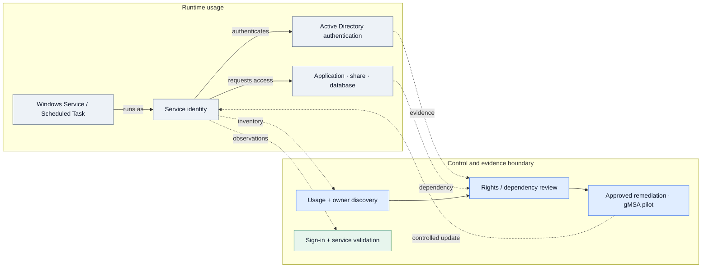
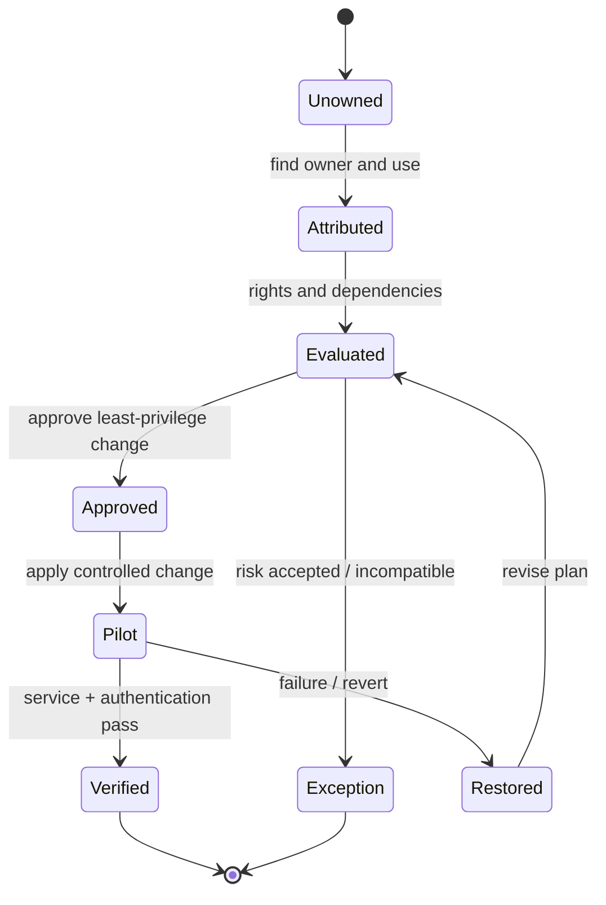

# IP-03: Service Account Security Assessment & Remediation

> **Type:** Repeatable Service Package  
> **Delivery Unit:** 1 Assessment & Remediation Cycle สำหรับ Account/ระบบที่กำหนด  
> **Baseline Effort:** 6 Man-days

## Objective

ตรวจสอบ Service Account และลดความเสี่ยงจากสิทธิ์เกินจำเป็นหรือการตั้งค่าที่ไม่ปลอดภัย

## Scope

ครอบคลุม AD DS/Windows Service Accounts และข้อมูลจากเครื่องมือ Identity Security (หากมี) ตามระบบที่ตกลง พร้อม Remediation เฉพาะรายการที่ได้รับอนุมัติ

## Architecture Mental Model

**System question:** Who is using this identity, and what capabilities can it exercise?

This is a conceptual system model, not a physical topology or a deployment blueprint. Solid arrows show an intended interaction or change; dashed arrows represent observation, constraints, or a proposed relationship.

## State & Control Model

**Invariants**

- Safety — Do not disable, rotate, or replace a service identity until workloads and owners are identified.
- Authorization — Changes must preserve only documented and approved privileges.
- Progress — Every reviewed account has a remediation, exception, or outstanding-dependency decision.

**Failure / recovery reasoning:** Service stops authenticating after a credential or rights change → revert the approved change and investigate hidden consumers or dependencies.

## Required Inputs / Prerequisites

รายการ Service Accounts, Account Owners, AD DS/Server Read Access, Logon & Service Dependency Information, Change Window

## Standard Delivery Activities

1. สำรวจ Account, Owner, Usage และ Dependency  (1.5 วัน)
2. วิเคราะห์ Privilege, Logon Rights และ Security Risks  (1.5 วัน)
3. จัดระดับความเสี่ยงและจัดทำ Remediation Plan  (1 วัน)
4. ปรับสิทธิ์/Configuration หรือ Pilot gMSA ตามความเหมาะสม  (1.5 วัน)
5. Validate และสรุปผล/รายการคงค้าง  (0.5 วัน)

## Deliverables

Service Account Inventory, Risk Register, Remediation Checklist และ Validation Results

## Acceptance Criteria

ระบุ Owner และ Risks ตาม Scope พร้อมบันทึก Remediation ที่อนุมัติและผลการตรวจหลังเปลี่ยนแปลง

## Reusable Delivery Assets

Service Account Register, Privilege Review Matrix, Remediation & Validation Checklist

## Assumptions & Exclusions

ไม่รวมการแก้ไข Service Account ทุกระบบทั้งองค์กร; การเปลี่ยน Credential ต้องผ่าน Change Approval

## Reuse Guidance

ก่อนใช้งานกับแต่ละองค์กร ให้ยืนยันจำนวนระบบและขอบเขตที่ต้องดำเนินการ, สิทธิ์เข้าถึง, ข้อกำหนดด้าน Security/Compliance, งานที่ขึ้นกับ Third Party, Change Window, ผู้รับผิดชอบ Validation และปรับ Effort ตาม Complexity จริง

งานที่อยู่นอก Scope ต้องระบุเป็น Additional Work Item ก่อนดำเนินการ

---
Template นี้เป็นเอกสารมาตรฐานกลางสำหรับปรับใช้ซ้ำ; ให้จัดทำ SOW ราย Engagement แยกต่างหาก
