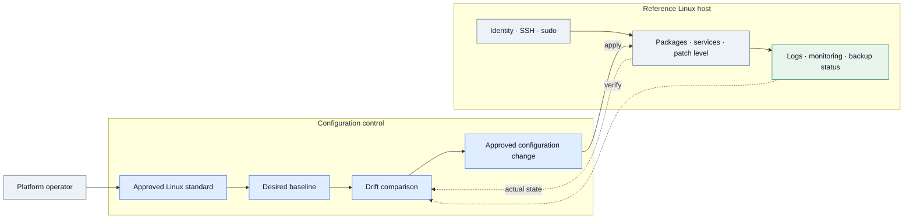
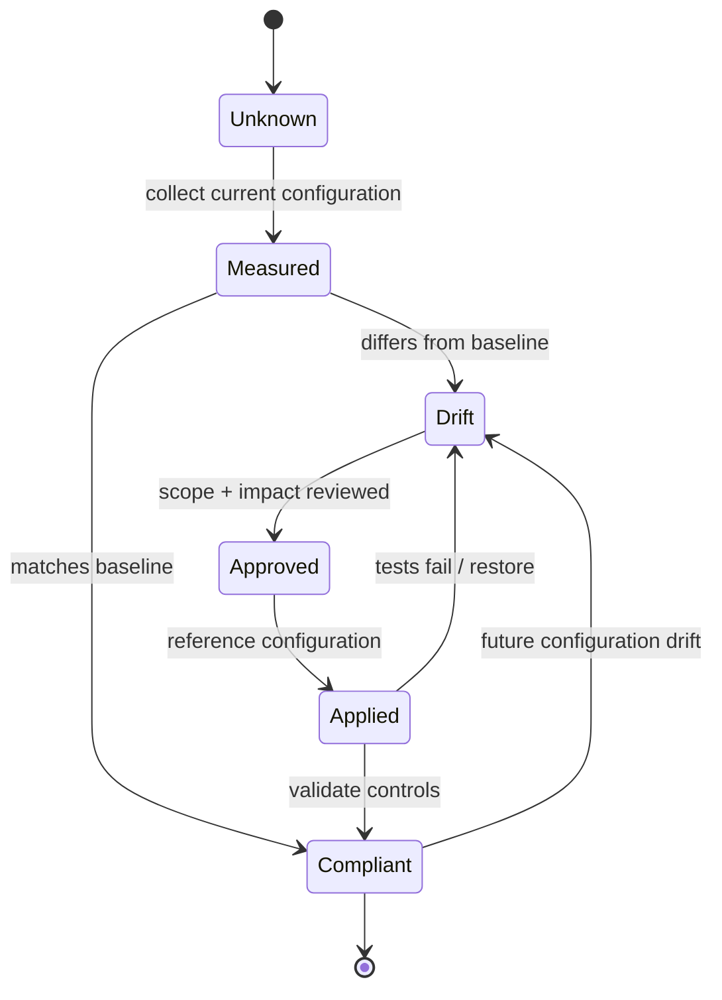

# IP-04: Linux Platform Management, Standardization & Security

> **Type:** Repeatable Service Package  
> **Delivery Unit:** One reference configuration for an agreed Linux distribution and version  
> **Baseline Effort:** 7.5 Man-days

## Objective
กำหนดแนวทางบริหารจัดการ Linux ให้เป็นมาตรฐาน พร้อมสร้าง Reference Configuration ที่สามารถนำไปใช้ซ้ำได้

## Scope
ทบทวนสภาพแวดล้อม Linux และจัดทำมาตรฐานการตั้งค่า การดูแลระบบ การติดตามสถานะ และการสำรองข้อมูลสำหรับกลุ่มระบบที่ตกลง

## Architecture Mental Model

**System question:** How do many Linux hosts converge on one declared operating baseline?

This is a conceptual system model, not a physical topology or a deployment blueprint. Solid arrows show an intended interaction or change; dashed arrows represent observation, constraints, or a proposed relationship.

## State & Control Model

**Invariants**

- Safety — Security and access changes must preserve an approved operational access path.
- Convergence — Drift is measured against the same versioned baseline, not against another arbitrary server.
- Scope — Reference validation does not imply fleet-wide deployment.

**Failure / recovery reasoning:** A baseline change breaks application access or management → revert the affected change, capture exception, and revise the baseline.

## Required Inputs / Prerequisites
รายการระบบและ Distribution/Version เป้าหมาย, นโยบายองค์กร, ทีมเจ้าของระบบ และข้อมูลเครื่องมือบริหารจัดการที่ใช้อยู่

## Standard Delivery Activities
1. สำรวจสภาพแวดล้อม Linux และ Current Configuration (1 วัน)
2. จัดทำ Standard Build และ Configuration Baseline (2 วัน)
3. จัดทำ Reference Configuration และเชื่อมต่อระบบบริหารจัดการที่มีอยู่ (2.5 วัน)
4. ตรวจสอบผล จัดทำ Operations Guideline และ Knowledge Transfer (2 วัน)

## Deliverables
Linux Standard Baseline, Reference Configuration, Validation Checklist และ Operations Guideline

## Acceptance Criteria
Reference Configuration ผ่านการทดสอบตาม Checklist ที่ตกลง และส่งมอบเอกสารสำหรับการนำไปใช้งานซ้ำ

## Reusable Delivery Assets
Linux Baseline Checklist, Build Standard, Configuration Record และ Validation Checklist

## Assumptions & Exclusions
ขอบเขตเป็นการสร้างมาตรฐานและ Reference Implementation; ไม่รวมการ Rollout ไปยัง Linux ทุกเครื่องในองค์กร

## Reuse Guidance
ระบุระบบเป้าหมาย Distribution/Version และข้อกำหนดให้ชัดเจนก่อนนำแพ็กเกจไปใช้ซ้ำ และปรับ Effort เมื่อมีหลาย Platform หรือความซับซ้อนเพิ่มขึ้น
