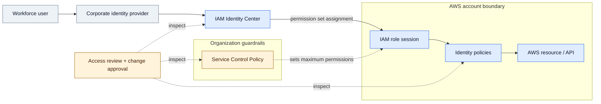
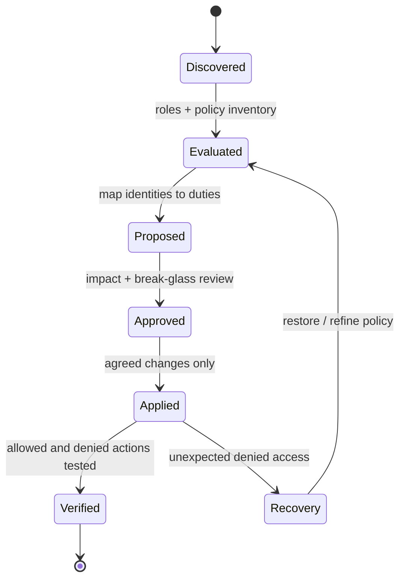

# IP-05: AWS Identity & Access Governance and Security Baseline

> **Type:** Repeatable Service Package  
> **Delivery Unit:** 1 Governance Assessment Cycle สำหรับ AWS Organization/Accounts ที่ตกลง  
> **Baseline Effort:** 6 Man-days

## Objective

ประเมินและยกระดับมาตรฐาน AWS Identity & Access Governance สำหรับบัญชีที่ตกลง

## Scope

ทบทวน Federation/Identity Center, IAM Role & Permission Set, MFA, SCP, Break-glass และ Access Review พร้อมปรับใช้ Priority Controls ที่อนุมัติ

## Architecture Mental Model

**System question:** Which layers authorize AWS access, and which only restrict it?

This is a conceptual system model, not a physical topology or a deployment blueprint. Solid arrows show an intended interaction or change; dashed arrows represent observation, constraints, or a proposed relationship.

## State & Control Model

**Invariants**

- Authorization — An SCP acts as a guardrail, not as a grant of access; identity permissions and applicable resource policies must also be evaluated.
- Safety — Validate break-glass and administrative access before applying broad Organization guardrails.
- Progress — Each high-priority finding is verified, excepted, or assigned an owner for follow-up.

**Failure / recovery reasoning:** Policy/SCP causes an unintended access denial → use approved recovery access and restore the last validated configuration.

## Required Inputs / Prerequisites

รายการ AWS Accounts, Identity Federation, สิทธิ์การอ่าน Configuration และ Account Owners

## Standard Delivery Activities

1. Review AWS Organization/Account และ Existing IAM  (1 วัน)
2. ออกแบบ IAM Standard, Federation, Roles และ Guardrails  (2 วัน)
3. Implement Priority Controls บน Accounts ที่ตกลง  (2 วัน)
4. Validate Access และส่งมอบ Governance Runbook  (1 วัน)

## Deliverables

AWS IAM Baseline, Priority Finding List, Applied Control Evidence และ Governance Guide

## Acceptance Criteria

มี IAM Gap Matrix และหลักฐานการปรับ Priority Controls พร้อมบันทึกการตรวจสอบผล

## Reusable Delivery Assets

Access Review Checklist, Permission Matrix, Governance Runbook

## Assumptions & Exclusions

การเปลี่ยน SCP/Role ต้องทดสอบผลกระทบและรับอนุมัติ; ไม่รวมการปรับสิทธิ์ทุก Account

## Reuse Guidance

ก่อนนำไปใช้ซ้ำ ให้ระบุจำนวนระบบและ Policy ที่ครอบคลุม กำหนดผู้อนุมัติการเปลี่ยนแปลง และปรับ Effort ตามความซับซ้อนจริง
