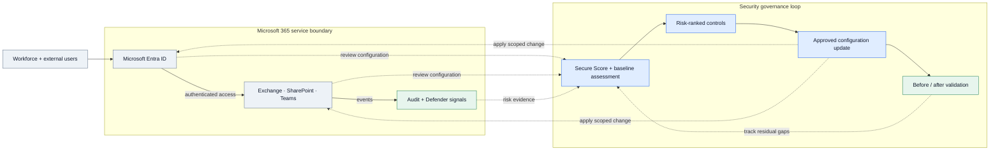
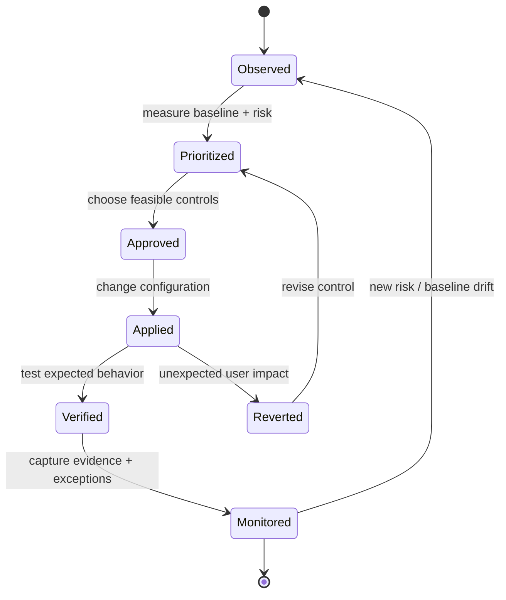

# IP-06: Microsoft 365 Security Baseline & Secure Score Improvement

> **Type:** Repeatable Service Package  
> **Delivery Unit:** 1 Microsoft 365 Tenant และชุด Priority Controls ที่ตกลง  
> **Baseline Effort:** 5 Man-days

## Objective

ประเมิน Security Baseline ของ Microsoft 365 และปรับปรุง Controls ที่มีผลต่อความเสี่ยงและ Secure Score

## Scope

ครอบคลุมการตั้งค่า Entra, Exchange Online, SharePoint/Teams และ Defender ตามสิทธิ์ใช้งานที่มี พร้อม Remediation ที่อนุมัติและ Exception Register

## Architecture Mental Model

**System question:** Where are user access decisions made, and how is configuration drift detected?

This is a conceptual system model, not a physical topology or deployment blueprint. Solid arrows represent interactions or changes; dashed arrows represent observation, constraints, or proposed relationships.

## State & Control Model

**Invariants**

- Safety — A score improvement is not proof that tenant risk is eliminated; prioritize independently using exposure and business impact.
- Change control — Do not deploy tenant-wide restrictions without an approved scope and validation path.
- Progress — Every selected control results in validated remediation, a tracked exception, or a documented blocker.

**Failure / recovery reasoning:** Conditional Access or workload control blocks legitimate business operations → revert the scoped change and use the evidence to refine policy.

## Required Inputs / Prerequisites

Tenant Configuration Access, License Inventory, Security Score Snapshot และผู้อนุมัติ Changes

## Standard Delivery Activities

1. Assess Tenant Configuration, Licensing และ Secure Score  (1 วัน)
2. จัดลำดับ Security Gaps และเลือก Priority Controls  (1 วัน)
3. Implement Remediation ที่ตกลง  (2 วัน)
4. Validate Configuration และจัดทำ Remaining Roadmap  (1 วัน)

## Deliverables

Security Gap Assessment, Remediation Record, Secure Score Snapshot และ Exception Register

## Acceptance Criteria

มีรายการ Security Gaps, Evidence ของการปรับค่าและผลตรวจสอบ, Exception Register และ Next-step Roadmap

## Reusable Delivery Assets

Security Baseline Checklist, Findings Register, Validation Record

## Assumptions & Exclusions

เป้าหมายการปรับปรุง Secure Score ขึ้นอยู่กับคะแนนเริ่มต้น สิทธิ์ใช้งาน และการอนุมัติเปลี่ยนแปลง ไม่รับประกันผลภายในระยะเวลาตัวอย่าง

## Reuse Guidance

ก่อนนำไปใช้ซ้ำ ให้ระบุจำนวนระบบและ Policy ที่ครอบคลุม กำหนดผู้อนุมัติการเปลี่ยนแปลง และปรับ Effort ตามความซับซ้อนจริง
