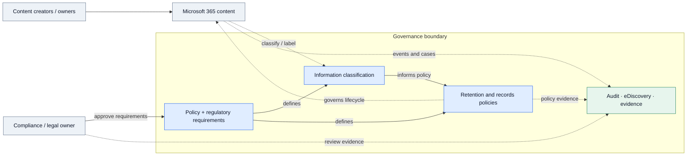
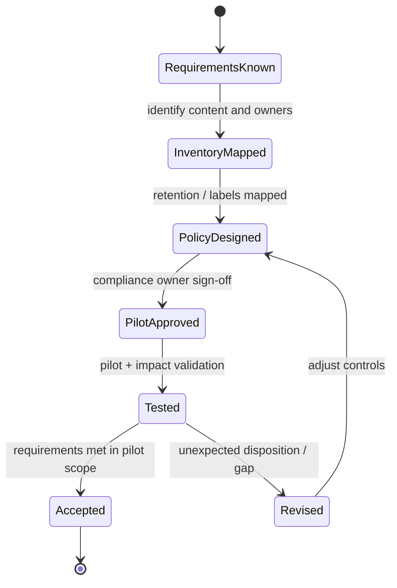

# IP-07: Microsoft 365 Zero Trust – Regulatory & Compliance Readiness

> **Type:** Repeatable Service Package  
> **Delivery Unit:** 1 Compliance Assessment and Policy Pilot สำหรับ Tenant/Policies ที่กำหนด  
> **Baseline Effort:** 6 Man-days

## Objective

ประเมินความพร้อมด้าน Data Governance และ Compliance บน Microsoft 365/Purview

## Scope

Review Information Protection, Retention, Audit, Records และ eDiscovery เทียบกับข้อกำหนดที่ลูกค้าระบุ พร้อมแก้ไข Controls ลำดับสำคัญเฉพาะขอบเขตที่อนุมัติ

## Architecture Mental Model

**System question:** How do information assets, governance requirements, and enforcement controls relate?

This is a conceptual system model, not a physical topology or deployment blueprint. Solid arrows represent interactions or changes; dashed arrows represent observation, constraints, or proposed relationships.

## State & Control Model

**Invariants**

- Safety — Retention or disposition configuration must not conflict with known legal hold or preservation obligations.
- Traceability — Each selected policy must map to a documented requirement and an accountable owner.
- Boundary — Technical readiness does not by itself constitute legal or regulatory certification.

**Failure / recovery reasoning:** Pilot reveals an unintended retention or deletion outcome → stop the rollout, preserve evidence, and have the requirement owner approve policy changes.

## Required Inputs / Prerequisites

ข้อกำหนด Compliance จากฝ่ายที่เกี่ยวข้อง, Purview Feature Inventory, Data Owners, นโยบายที่มีอยู่

## Standard Delivery Activities

1. กำหนด Requirement และ Control Scope ร่วมกับทีม Compliance  (1 วัน)
2. Review Purview Capabilities และ Current Settings  (1.5 วัน)
3. จัดทำ Gap Analysis และ Prioritized Controls  (1 วัน)
4. Implement/Pilot Priority Controls ที่ตกลง  (1.5 วัน)
5. Validate และส่งมอบ Compliance Remediation Roadmap  (1 วัน)

## Deliverables

Compliance Gap Matrix, Control Evidence, Pilot Configuration และ Remediation Roadmap

## Acceptance Criteria

ส่งมอบ Gap Matrix, ผลการทดสอบ Policy Pilot และ Roadmap สำหรับปรับปรุง Controls

## Reusable Delivery Assets

Compliance Gap Matrix, Policy Decision Register, Validation Checklist

## Assumptions & Exclusions

ไม่รวม Legal Opinion/การรับรองผ่านข้อกำหนดทางกฎหมาย; การใช้ Feature ขึ้นกับ License

## Reuse Guidance

ก่อนนำไปใช้ซ้ำ ให้ระบุจำนวนระบบและ Policy ที่ครอบคลุม กำหนดผู้อนุมัติการเปลี่ยนแปลง และปรับ Effort ตามความซับซ้อนจริง
