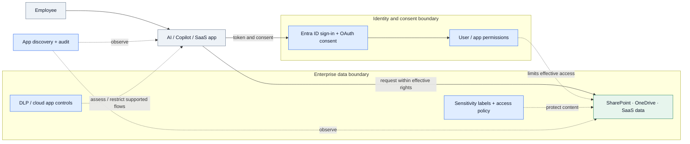
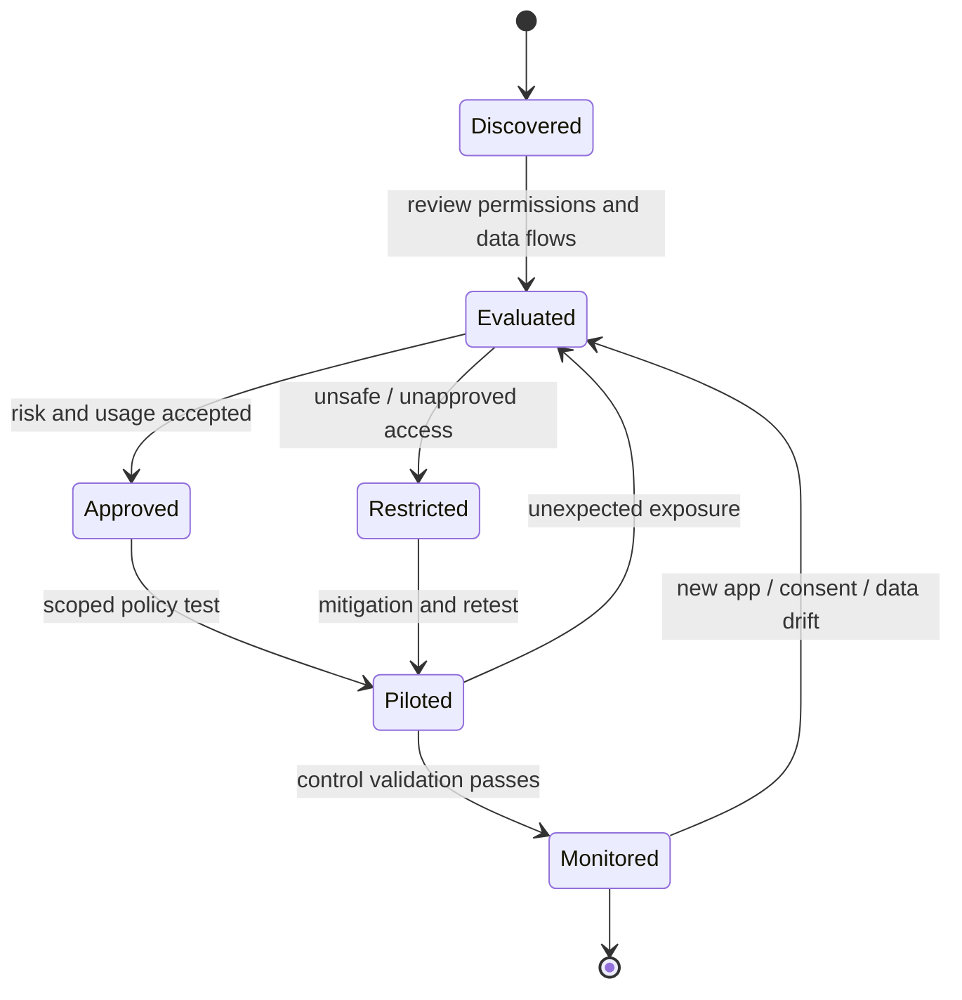

# IP-08: Microsoft 365 Zero Trust – Secure AI Apps & Data

> **Type:** Repeatable Service Package  
> **Delivery Unit:** 1 AI App/Data Risk Assessment และ Policy Pilot ที่กำหนด  
> **Baseline Effort:** 6 Man-days

## Objective

ประเมินและจำกัดความเสี่ยงจาก AI Apps/Copilot และการเข้าถึงข้อมูลบน Microsoft 365

## Scope

ทบทวน AI/Copilot Usage, Enterprise/OAuth Apps, Data Exposure, DLP, Sensitivity Labels และ Cloud App Controls โดย Pilot การบังคับใช้นโยบายที่เลือก

## Architecture Mental Model

**System question:** What can an AI app see, and which controls constrain that access?

This is a conceptual system model, not a physical topology or deployment blueprint. Solid arrows represent interactions or changes; dashed arrows represent observation, constraints, or proposed relationships.

## State & Control Model

**Invariants**

- Access — AI assistants should not receive broader effective access than the approved user/app permissions permit.
- Data protection — Overshared source content remains a risk even when the AI system respects existing permissions.
- Control scope — DLP, discovery, and app governance capabilities vary by product and licensing; validate policy reach rather than assuming universal coverage.

**Failure / recovery reasoning:** An AI/OAuth app gains overly broad consent or exposes sensitive content → restrict or revoke the scoped access, assess affected data, then retest policies.

## Required Inputs / Prerequisites

รายการ Apps/Use Cases, Approved Tenant Access, Data Classification และ Policies ปัจจุบัน

## Standard Delivery Activities

1. Discover AI Apps, Copilot Use Cases และ Data Flows  (1 วัน)
2. Assess App Permissions และ Data Exposure Risks  (1.5 วัน)
3. ออกแบบ DLP/Label/App Control Priority Policies  (1 วัน)
4. Implement/Pilot Agreed Controls  (1.5 วัน)
5. Validate และจัดทำ Usage/Security Guidance  (1 วัน)

## Deliverables

AI App/Data Risk Assessment, Policy Matrix, Pilot Control Evidence และ Action Plan

## Acceptance Criteria

ส่งมอบ Risks, Policy Matrix และหลักฐานทดสอบ Pilot พร้อมรายการข้อจำกัดและ Next Actions

## Reusable Delivery Assets

AI App Assessment Checklist, Policy Matrix, Test Cases

## Assumptions & Exclusions

เน้น Assessment และ Selected Controls ไม่รวม Full Tenant Rollout; ฟีเจอร์ขึ้นกับ License

## Reuse Guidance

ก่อนนำไปใช้ซ้ำ ให้ยืนยัน Delivery Unit, Scope Boundary, Dependencies, ผู้รับผิดชอบ Validation และปรับ Effort ตามขนาดงานจริง
