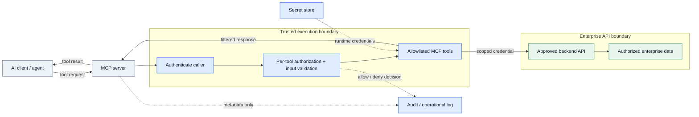
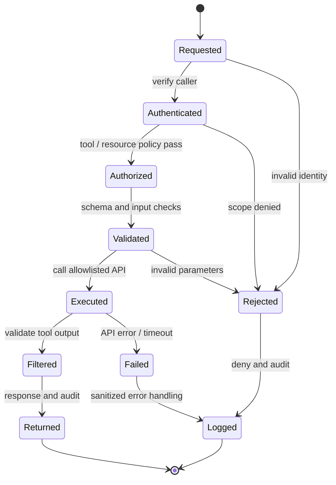

# IP-09: Enterprise MCP Server Implementation & Integration

> **Type:** Repeatable Service Package  
> **Delivery Unit:** 1 MCP Server, 1 API/Data Source ที่พร้อมใช้ และไม่เกิน 3 Tools  
> **Baseline Effort:** 6 Man-days

## Objective

ออกแบบและพัฒนา MCP Server เพื่อให้ AI Clients เรียกใช้งาน Enterprise APIs/ข้อมูลที่ได้รับอนุญาต

## Scope

สร้าง MCP Server, Tools, Authentication/Authorization, Secrets/Logging และ Deployment สำหรับ Use Case ที่ตกลง โดยใช้ Enterprise API หรือ Data Source ที่มีอยู่

## Architecture Mental Model

**System question:** How is a natural-language tool request bounded before it reaches enterprise data?

This is a conceptual system model, not a physical topology or deployment blueprint. Solid arrows represent interactions or changes; dashed arrows represent observation, constraints, or proposed relationships.

## State & Control Model

**Invariants**

- Authorization — Each tool call is checked against the authenticated caller, tool and resource; default to deny.
- Data boundary — External content and tool output are untrusted data, not instructions that can expand permissions.
- Observability — Log operational and authorization outcomes without storing tokens, secrets, or unnecessary sensitive payloads.

**Failure / recovery reasoning:** A tool is called with an invalid identity, unauthorized scope, or untrusted parameters → deny before backend execution and record a sanitized audit event.

## Required Inputs / Prerequisites

Agreed Use Cases, API Specifications, Development/Test Environment, Service Identity และ Data Owner

## Standard Delivery Activities

1. กำหนด Use Case, Tool Contract และ API/Data Source  (1 วัน)
2. ออกแบบ MCP Architecture และ Access Control  (1 วัน)
3. พัฒนา MCP Server และ Tools ตาม Scope  (2 วัน)
4. Deploy, ตั้งค่า Logging/Secrets และ Functional/Security Test  (1.5 วัน)
5. จัดทำ Runbook และ Knowledge Transfer  (0.5 วัน)

## Deliverables

MCP Server & Selected Tools, Test Evidence, Configuration/Deployment Guide

## Acceptance Criteria

มี MCP Tools ที่ผ่านการทดสอบการทำงานและสิทธิ์ใช้งานตาม Test Cases พร้อม Deployment Guide

## Reusable Delivery Assets

Tool Contract, Integration Test Matrix, Deployment Runbook

## Assumptions & Exclusions

ประมาณการ 6 วันสำหรับ 1 Data Source/API ที่พร้อมใช้ และไม่เกิน 3 Tools; ไม่รวมสร้าง Backend API ใหม่หรือ HA

## Reuse Guidance

ก่อนนำไปใช้ซ้ำ ให้ยืนยัน Delivery Unit, Scope Boundary, Dependencies, ผู้รับผิดชอบ Validation และปรับ Effort ตามขนาดงานจริง
