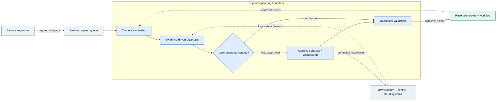
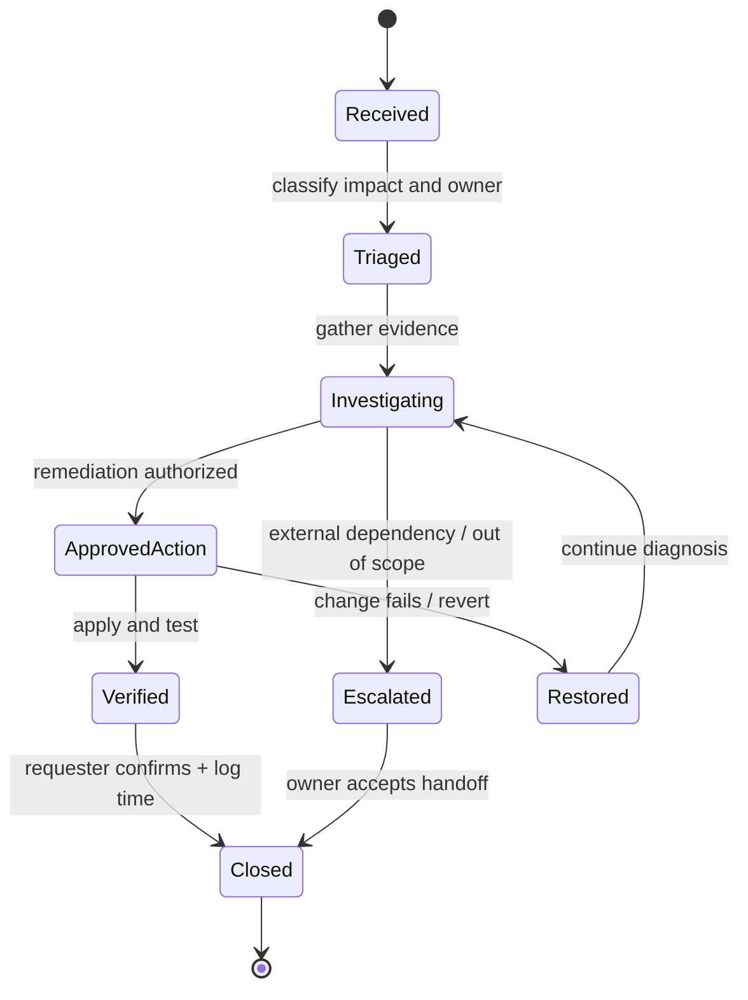

# IP-10: Professional Support

> **Type:** Repeatable Service Package  
> **Delivery Unit:** 1 Support Block ขนาดตัวอย่าง 100 ชั่วโมง ปรับเพิ่มลดได้ตาม Engagement  
> **Baseline Effort:** 100 ชั่วโมง

## Objective

บริการให้คำปรึกษาและแก้ไขปัญหาระบบ Infrastructure, Identity, Microsoft 365 และ Cloud ตามที่ร้องขอ

## Scope

Architecture/Design Review, Troubleshooting, Security Advisory, Configuration Review, Change Support, Health Check และ Knowledge Transfer ตาม Service Requests ที่ตกลง

## Architecture Mental Model

**System question:** How does a reported symptom become a verified system outcome without bypassing ownership?

This is a conceptual system model, not a physical topology or deployment blueprint. Solid arrows represent interactions or changes; dashed arrows represent observation, constraints, or proposed relationships.

## State & Control Model

**Invariants**

- Safety — Any production change requires the relevant owner's approval and a proportionate verification or rollback plan.
- Accountability — Each request has an owner, an outcome, and recorded effort; a handoff is not the same as a technical resolution.
- Contract — Effort-based support does not automatically imply 24×7 coverage or an incident-response SLA.

**Failure / recovery reasoning:** No approved mitigation exists or required access is unavailable → escalate to the accountable owner, preserve the incident evidence, and record the handoff.

## Required Inputs / Prerequisites

Service Request Channel, Request Approver, Service Windows, Support Contacts, Work Log Template

## Standard Delivery Activities

1. รับและจัดลำดับ Service Requests
2. วิเคราะห์ Incident/Problem และให้ Technical Recommendation
3. Review/Support การเปลี่ยนแปลง Configuration
4. บันทึก Effort, ผลดำเนินงาน และ Knowledge Transfer

## Deliverables

Work Log/Time Sheet, Technical Findings และ Recommendation ตามงานที่ดำเนินการ

## Acceptance Criteria

มี Service Records, Time Sheet และ Findings/Recommendations สำหรับคำขอที่ดำเนินการในรอบ

## Reusable Delivery Assets

Service Request Register, Time Sheet, Technical Findings & Handover

## Assumptions & Exclusions

บริการตามการใช้จริงภายใน 100 ชั่วโมง (เทียบเท่า 12.5 Man-days); ไม่รวม 24×7 On-call หรือ Guaranteed SLA

## Reuse Guidance

ก่อนนำไปใช้ซ้ำ ให้ยืนยัน Delivery Unit, Scope Boundary, Dependencies, ผู้รับผิดชอบ Validation และปรับ Effort ตามขนาดงานจริง
